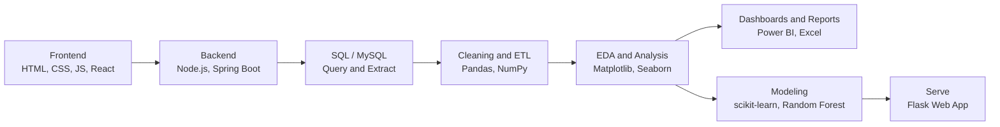

<div align="center">


# Ayush Satishrao Kurhade
**AI & Data Science Student · Full-Stack Developer · Data Analyst**

<a href="https://git.io/typing-svg">
  
</a>
<br/><br/>


</div>

## About Me

```java
public class Ayush {
    String name      = "Ayush Kurhade";
    String education = "AI & Data Science Student";
    String location  = "Amravati, Maharashtra, India";
    String[] roles   = {"Frontend / Full-Stack Developer", "Data Analyst", "ML Engineer", "Business Analyst"};
    String[] stack   = {"Java", "Python", "SQL", "JavaScript", "Flask", "Node.js", "React"};
    String[] exploring = {"Spring Boot", "Advanced Java", "DSA", "Open Source", "Business Process Automation"};

    public String mission() {
        return "Build useful software and turn data into decisions, and do it in public.";
    }
}
```

<table>
<tr>
<td width="50%">

### Currently
- Analysing and transforming data with **SQL, Python & Excel** to solve business problems
- Building, training and evaluating **ML models** on real-world datasets
- Solving **DSA** problems and learning **Core Java, Advanced Java & Spring Boot**
- Exploring **Git, GitHub, Open Source** and software engineering fundamentals
</td>
<td width="50%">

### What I Do
- Perform **data analysis** and extract meaningful business insights
- Build **dashboards & reports** for data-driven decision-making
- Build **front ends** and connect them to back ends using **Node.js**
- Work on **business process automation** and workflow optimization
</td>
</tr>
</table>

## Skills

### Data Analysis & Business Intelligence
`Data Cleaning` · `Data Wrangling` · `Exploratory Data Analysis (EDA)` · `Statistical Analysis` · `KPI Tracking` · `Data Visualization` · `Dashboard Development` · `Business Analysis` · `A/B Testing` · `Hypothesis Testing` · `ETL Processes`


### SQL & Database Development
`SQL` · `Joins` · `Subqueries` · `CTEs` · `Window Functions` · `Aggregations` · `Indexing` · `Query Optimization` · `Stored Procedures` · `Views` · `Database Design` · `Data Modeling`


### Programming Languages


### Data Libraries


### Machine Learning
`Supervised Learning` · `Unsupervised Learning` · `Regression` · `Classification` · `Clustering` · `Linear Regression` · `Logistic Regression` · `Decision Trees` · `Random Forest` · `XGBoost` · `SVM` · `KNN` · `K-Means` · `Feature Engineering` · `Model Evaluation` · `Hyperparameter Tuning`

### Web & Full-Stack


### Tools


## My Workflow



## Featured Projects

| Project | Description | Tech |
|---|---|---|
| [**CrimeScope**](https://github.com/AyushKurhade/CrimeScope) | Interactive Power BI dashboard analysing simulated Indian crime data (2018–2023): crime trends, state and category comparisons, and case resolution rates | `Power BI` |
| [**Customer Support Ticket Management System**](https://github.com/AyushKurhade/Customer-Support-Ticket-Management-System) | Web-based ticketing system to create, assign, track and resolve tickets, with role-based access and dashboards | `Python` `Flask` `MySQL` |
| [**IPL Win Predictor**](https://github.com/AyushKurhade/IPL-Win-Predictor) | End-to-end ML web app that predicts winning probabilities during the second innings of an IPL match | `Python` `Flask` `scikit-learn` `Random Forest` |
| [**LifeLink**](https://github.com/AyushKurhade/lifelink) | Emergency blood response app connecting patients with nearby donors in real time, with instant donor alerts and live maps | `Flutter` `Dart` `Firebase` |
| [**FocusFlow Pomodoro**](https://github.com/AyushKurhade/Focusflow-pomodoro) | Interactive Pomodoro study timer with custom focus sessions, task tracking, study analytics, session history and daily goals | `HTML` `CSS` `JavaScript` |
| [**Java Learning**](https://github.com/AyushKurhade/Java_learning) | Core Java concepts, OOP, strings, collections, garbage collection, pattern printing and DSA problems with notes | `Java` |

## GitHub Stats

<p align="center">
<picture>
<source media="(prefers-color-scheme: light)" srcset="https://github-readme-stats.shion.dev/api?username=AyushKurhade&theme=default&hide_border=false&include_all_commits=false&count_private=false" />

</picture>
<picture>
<source media="(prefers-color-scheme: light)" srcset="https://github-readme-stats.shion.dev/api/top-langs/?username=AyushKurhade&theme=default&hide_border=false&layout=compact" />

</picture>
<br />
<picture>
<source media="(prefers-color-scheme: light)" srcset="https://streak-stats.demolab.com/?user=AyushKurhade&theme=default&hide_border=false" />

</picture>
</p>

## GitHub Trophies

<p align="center">
<picture>
<source media="(prefers-color-scheme: light)" srcset="https://github-profile-trophy.vercel.app/?username=AyushKurhade&theme=flat&no-frame=false&no-bg=false&margin-w=4" />

</picture>
</p>

## Let's Connect

<div align="center">

<a href="mailto:aayushkurhade068@gmail.com"></a>
<a href="https://linkedin.com/in/ayushk30"></a>
<a href="https://x.com/ayush_k_030"></a>
<a href="https://www.instagram.com/ayush_k_30"></a>
<a href="https://stackoverflow.com/users/32332866/cyrus-30"></a>
<a href="https://discord.gg/pAak8W2yM"></a>
<a href="https://in.pinterest.com/ayush_k_30/"></a>
<a href="https://www.reddit.com/user/Icy_Hall_2425/"></a>
<a href="https://github.com/AyushKurhade"></a>

<br/><br/>


</div>


